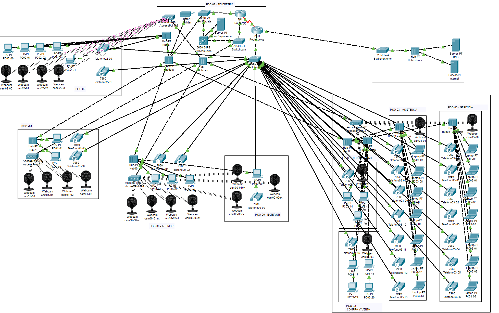
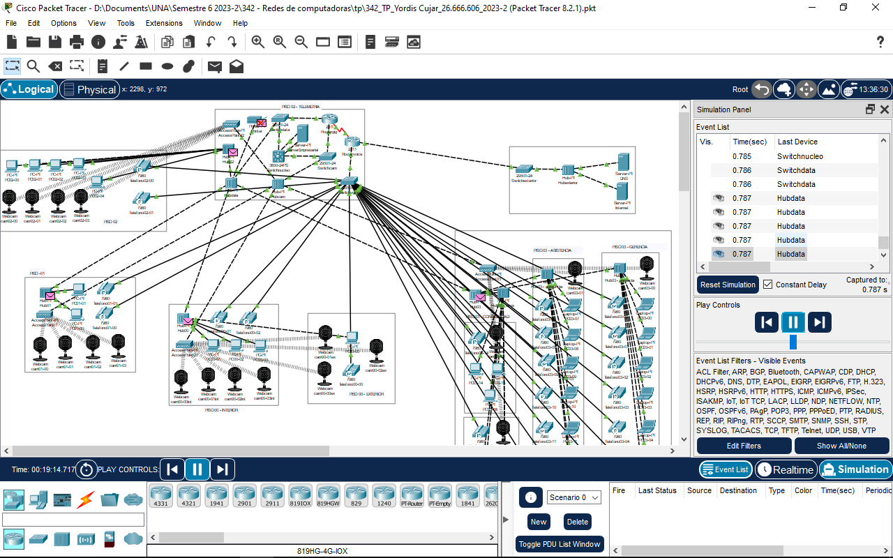

# Diseño e Implementación de Red LAN Empresarial (Gigabit Ethernet + VoIP + Videovigilancia IP)

Proyecto de diseño de una red LAN corporativa de 4 pisos, incluyendo actualización a Gigabit Ethernet, segmentación por VLANs, telefonía IP y videovigilancia IP inalámbrica, con su respectivo Plan de Implementación (presupuesto, cronograma y recursos).

> Trabajo realizado como práctico académico para la asignatura *Redes de Computadoras* (UNA, Venezuela). Se documenta aquí como muestra de habilidades en diseño de redes, direccionamiento IP, VLANs, VoIP y planificación de proyectos de infraestructura.

## Diagrama de la red



## Contexto del problema

Una empresa distribuida en 4 niveles (Planta Baja + 3 pisos) requiere modernizar su infraestructura de red, que actualmente opera con equipos 10/100 Mbps y cableado CAT5. El proyecto contempla:

- Migración a **Gigabit Ethernet** (cableado CAT6/CAT6A).
- **31 estaciones de trabajo** distribuidas en los 4 niveles.
- **23 teléfonos IP** (telefonía IP centralizada en el router de voz).
- **Videovigilancia IP inalámbrica** (cámaras conectadas vía Access Points).
- Conectividad a Internet redundante (dos proveedores) con NAT/PAT.
- Segmentación de tráfico por VLANs y controles de seguridad (802.1X, WPA2, ACLs, RADIUS).

## Metodología de diseño

Se aplicó un **modelo híbrido Top-Down / Bottom-Up**, en 6 fases:

1. Recolección de información (infraestructura y requerimientos actuales).
2. Análisis de requerimientos (conectividad, ancho de banda, seguridad).
3. Diseño lógico (VLANs, topología lógica, protocolos de enrutamiento).
4. Diseño físico (cableado estructurado, gabinetes, ubicación de equipos).
5. Simulación y pruebas (Cisco Packet Tracer).
6. Documentación (diagramas, tablas de direccionamiento IP).

## Arquitectura de red

**Topología física:** estrella, con cableado estructurado desde gabinetes por piso hacia un cuarto de telecomunicaciones central (piso 2).

**Topología lógica:** árbol, con un switch de núcleo (`Switchnucleo`) interconectando los switches de distribución de cada piso.

**Equipos principales:**

| Rol | Equipo |
|---|---|
| Núcleo | Switch Cisco 3650-24PS |
| Distribución | Switches Cisco 2950-24 (datos, voz, cámaras) |
| Enrutamiento | 2x Router Cisco 2811 (datos / voz) |
| Servidor | Servidor de empresa (DHCP + aplicaciones) |
| Acceso inalámbrico | Access Points 802.11ac |

## Segmentación VLAN

| VLAN | Función | Red |
|---|---|---|
| 10 | Datos | 192.168.10.0/24 |
| 20 | Voz (VoIP) | 192.168.20.0/24 |
| 30 | Videovigilancia | 192.168.30.0/24 |
| 100 | Servidores | 192.168.100.0/24 |

## Enrutamiento y seguridad

- Enrutamiento inter-VLAN a través del switch de núcleo y enlace serial entre routers.
- **OSPF** para enrutamiento interno, **BGP** hacia proveedores de Internet.
- **NAT/PAT** para salida a Internet.
- Seguridad: autenticación **802.1X**, servidor **RADIUS** centralizado, cifrado **WPA2** en la red inalámbrica, ACLs entre VLANs y VPN site-to-site con proveedores.

## Cálculo de rendimiento (ejemplo)

Transferencia de un archivo de 3.5 GB entre un usuario de Planta Baja y un usuario del Piso 3, con enlaces Gigabit Ethernet dedicados por estación:

```
Velocidad de enlace: 1 Gbps (125 MB/s)
Tamaño del archivo:  3,500 MB
Tiempo estimado:     3,500 MB / 125 MB/s ≈ 28 segundos
```

## Simulación

La red completa fue modelada y probada en **Cisco Packet Tracer 8.2.1**, incluyendo configuración CLI de routers y switches (VLANs, DHCP, telefonía IP, enrutamiento), y pruebas de conectividad extremo a extremo entre pisos.



## Plan de implementación

El plan de implementación se basó en la metodología de Cisco *"Proven Implementation Methodology"*, organizada en 6 fases de despliegue (preparación → cuarto de telecomunicaciones → piso 1 → pisos 2 y 3 → acceso inalámbrico → puesta en operación), con:

- **Cronograma:** 8 semanas.
- **Presupuesto estimado:** ~$106,600 USD (equipos, cableado, instalación y capacitación).
- Recursos de personal, equipos, software/licencias e infraestructura detallados.

## Contenido del repositorio

```
├── README.md                    # Este documento
├── informe-diseno-red.pdf       # Informe técnico completo (diseño + plan de implementación)
├── red-lan-empresa.pkt          # Archivo de simulación (Cisco Packet Tracer 8.2.1)
└── diagramas/
    ├── topologia-completa.png       # Diagrama final de la topología de red
    └── captura-packet-tracer.png    # Captura del simulador en funcionamiento
```

## Herramientas utilizadas

- Cisco Packet Tracer 8.2.1
- IOS de Cisco (routers 2811, switches 2950/3650)
- Estándares ANSI/TIA/EIA-568, IEEE 802.3ab (Gigabit Ethernet), IEEE 802.11ac

## Autor

**Yordis Cujar** — Técnico en Sistemas Informáticos, con experiencia en Linux SysAdmin y desarrollo Full Stack.
[GitHub](https://github.com/yordisc)
